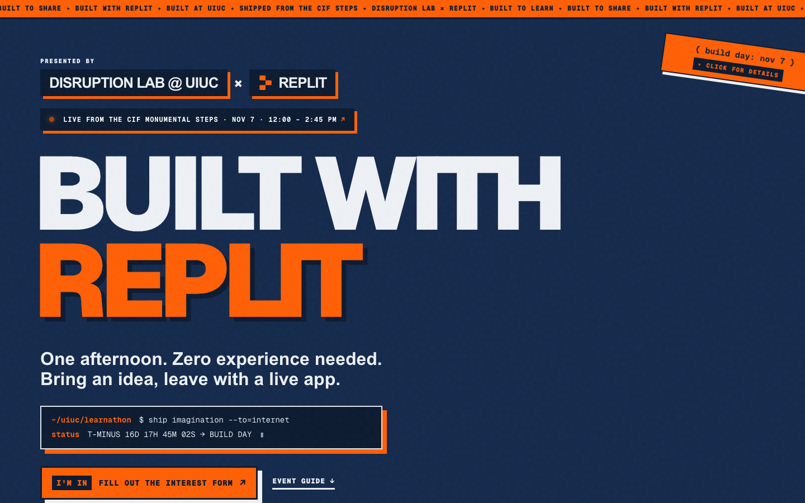
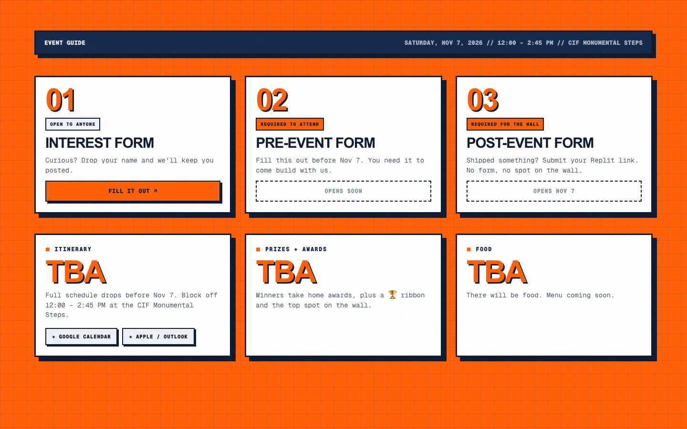
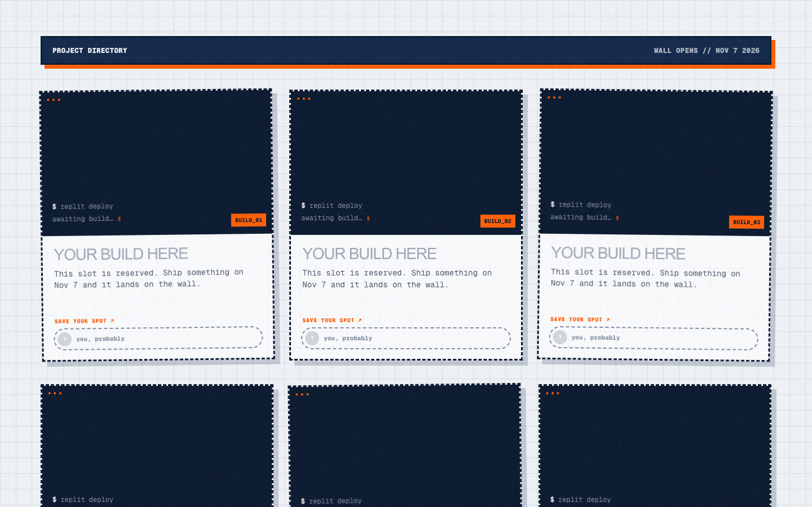
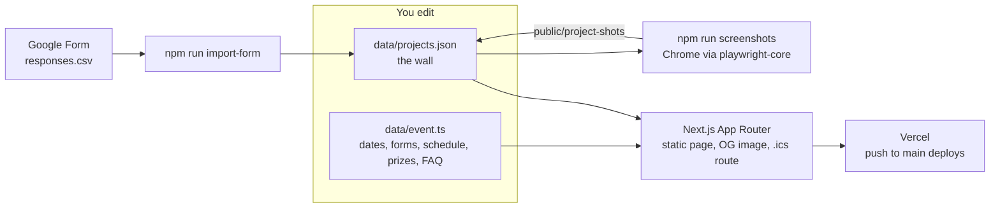

<p align="center"></p>

# Built with Replit: UIUC Learnathon Wall

[](https://learnathon.bhanusadhu.com)


The website for the **Disruption Lab × Replit Learnathon**, a free, no experience needed build day at UIUC: **Saturday, Nov 7, 2026 · 12:00–2:45 PM · CIF Monumental Steps.** Before the event it is the event page. After the event it becomes a wall of every app people built.

**See it live: [learnathon.bhanusadhu.com](https://learnathon.bhanusadhu.com)**



## At a glance

* **One site, two phases.** Pre-event it shows a countdown, three sign-up steps and an FAQ. Post-event the same page turns into a project wall with a screenshot, a one-liner, a live link and the builder's name and LinkedIn for each app. The headline copy, link preview and footer switch on their own once projects exist.
* **Run from one file.** Dates, forms, schedule, food, prizes and FAQ all live in [`data/event.ts`](data/event.ts). Leave a value empty and the site shows "TBA" or "opens soon" in its place. No CMS and no database.
* **From form response to wall in two commands.** A Google Form CSV becomes `data/projects.json`, and every published Replit app is screenshotted automatically with your installed Chrome. Resubmissions, awards and existing screenshots are handled safely on re-run.

## What is on the site

| Section | What it shows |
| --- | --- |
| **Hero** | Disruption Lab @ UIUC × Replit branding, a live countdown ("LIVE NOW" during the event, "SHIPPED" after), and a button to whichever sign-up form is current |
| **Date sticker** (top right) | Click to open the event details: date, time, location, add to calendar, directions |
| **Event Guide** | The three forms in order (interest → pre-event → post-event), itinerary, awards, food, FAQ |
| **Project wall** | Six "your build here" placeholders before the event; every submitted app after it. Winners get a 🏆 ribbon and move to the top |
| **Footer** | Disruption Lab Instagram, LinkedIn, website, and this repository |

Extras: add to calendar (Google Calendar, plus an `.ics` file for Apple and Outlook), a generated link-preview card for texts and social posts, a favicon and iPhone icon, a themed 404 page, and load-in and scroll animations that turn off for anyone with reduced motion enabled.

| Event Guide | Project wall |
| --- | --- |
|  |  |

*Captured from the live site while the pre-event form, itinerary, food and prizes were still to be announced.*

## How it works



Event info and projects are plain files read at build time, so every change is a git commit and the live site is just `main`. The home page switches between its pre-event and post-event copy based on whether `data/projects.json` has any entries, and the project sort ([`lib/projects.ts`](lib/projects.ts)) puts winners first in prize order.

## Updating event info

**Almost everything lives in one file: [`data/event.ts`](data/event.ts).** Leave a value empty (`null` or `[]`) and the site shows "TBA" or "opens soon".

| Setting | What it controls |
| --- | --- |
| `forms.interest` | Interest form link. Live now. |
| `forms.pre` | Pre-event form (**required to attend**). Once set, it becomes the main hero button and step 02 goes live. |
| `forms.post` | Post-event form (**required to get on the wall**). Step 03 goes live and the empty wall slots link to it. |
| `itinerary` | Schedule rows, e.g. `{ time: "12:00 PM", title: "Kickoff", detail: "Intro to Replit Agent" }` |
| `food` | e.g. `"Pizza + drinks"` |
| `prizes` | Awards in display order, e.g. `{ name: "Grand Prize", reward: "Trophy + $200" }` |
| `faq` | Question and answer pairs in the FAQ card |
| `links` | Disruption Lab Instagram, LinkedIn, website, and this repo |
| `start` / `end` | Event time. Drives the countdown and the calendar links. |
| `siteUrl` | The live URL. Change it when the domain changes (see [Moving to a new domain](#moving-to-a-new-domain)). |

Push to `main` and the live site updates in about 30 seconds.

## Post-event form

This is the form people fill out to get their app on the wall. The importer reads its responses, so use these questions (the exact wording can vary, but keep the keywords in **bold**):

| Question | Type | Required | Tip |
| --- | --- | --- | --- |
| Full **name** | Short answer | ✓ | Don't put "project" or "app" in this title |
| **Project name** | Short answer | ✓ | |
| One-line **description** | Short answer | ✓ | Response validation → Length → max 120 characters |
| **Replit** app link | Short answer | ✓ | Response validation → Contains → `.replit.app` |
| **LinkedIn** profile URL | Short answer | | |
| **Headshot** | File upload (images, 1 file) | | Requires respondents to sign in with Google |

Put this in the form description: *"Before submitting, open your app in Replit and hit **Publish** so you have a `.replit.app` link. Unpublished apps can't go on the wall."*

You don't need to ask for screenshots. They are taken automatically from the Replit link.

## After the event: putting projects on the wall

```bash
# 1. Google Form → Responses → ⋮ → Download responses (.csv)
#    Save it as form-data/responses.csv
#    (Optional) Download the headshot uploads folder from Drive and unzip it to form-data/uploads
#    form-data/ is gitignored because it contains emails.

npm run import-form -- form-data/responses.csv --uploads form-data/uploads

# 2. Screenshot every app (uses your installed Chrome).
#    Lists anyone whose app isn't published on Replit yet, so you can follow up.
npm run screenshots

# 3. Check it locally, then commit + push.
npm run dev
```

* **Resubmissions:** run the import again. The latest submission per project title wins, and existing screenshots and awards are kept.
* **Retry failed screenshots:** `npm run screenshots -- <slug> <slug>`. Redo all of them with `-- --all`.

### Winners

1. Add the awards to `prizes` in `data/event.ts`.
2. Add `"award": "<award name>"` to each winning project in `data/projects.json`.

Winners get a 🏆 ribbon, move to the top of the wall, and are listed under their award in the Event Guide.

### Editing a project by hand

Each entry in [`data/projects.json`](data/projects.json):

```json
{
  "slug": "quad-eats",
  "title": "Quad Eats",
  "description": "Finds the shortest dining hall line on campus.",
  "url": "https://quad-eats.replit.app",
  "screenshot": "/project-shots/quad-eats.png",
  "creator": {
    "name": "Priya Natarajan",
    "linkedin": "https://www.linkedin.com/in/priya",
    "avatar": "/avatars/priya-natarajan.jpg"
  },
  "award": "Grand Prize"
}
```

`screenshot`, `linkedin`, `avatar` and `award` are optional. A missing screenshot shows the title on a dark screen, and a missing avatar shows initials.

## Link previews and icons

When the link is texted (iMessage, WhatsApp) or posted (Instagram bio, Discord, LinkedIn, X), apps show a preview card. It comes from:

| File | What it is |
| --- | --- |
| [`app/opengraph-image.tsx`](app/opengraph-image.tsx) | The 1200×630 preview image. Before the event it shows "Free · No experience needed" and the date; after, the number of builds. |
| [`app/layout.tsx`](app/layout.tsx) | The preview title and description. These also switch automatically once projects are added. |
| [`app/favicon.ico`](app/favicon.ico) | Browser tab icon (official Illinois Block I from cdn.brand.illinois.edu) |
| [`app/apple-icon.png`](app/apple-icon.png) | iPhone icon, used for Messages previews and home-screen shortcuts |

Apps cache previews, so after changing them, test with a fresh link such as `https://learnathon.bhanusadhu.com/?v=2`, or use [opengraph.xyz](https://www.opengraph.xyz).

## Moving to a new domain

1. In Vercel: **Project → Settings → Domains → Add**, and enter the new domain.
2. At the domain's registrar, add the DNS record Vercel shows. A subdomain is usually a `CNAME` to `cname.vercel-dns.com`; a root domain takes an `A` record.
3. Change `siteUrl` in `data/event.ts` to the new URL, then push. This keeps link previews and calendar invites pointing at the right place.
4. Optional: in Vercel, redirect the old domain to the new one.

## Tech stack

| Layer | Choice |
| --- | --- |
| Framework | Next.js 16 (App Router), React 19, TypeScript |
| Styling | Plain CSS in [`app/globals.css`](app/globals.css) on the Illinois palette (Illini blue and orange), Tailwind 4 for its base reset only, Geist for type |
| Data | Files in [`data/`](data/), no database |
| Tooling | Node scripts, `playwright-core` driving your installed Chrome for screenshots |
| Hosting | Vercel, with every push to `main` deployed to production |

```
app/            page, layout, 404, preview image, icons, calendar file route
components/     hero pieces, event guide, project cards, countdown terminal, scroll animations
data/           event.ts (event info) + projects.json (the wall)
docs/images/    screenshots used in this README
lib/            project sorting, calendar links, shared types
scripts/        import-form.mjs (CSV → projects.json), screenshots.mjs
public/         avatars/, project-shots/, brand/
```

## Run it locally

Requires Node 20+.

```bash
npm install
npm run dev      # http://localhost:3000
npm run build    # production build, same as Vercel runs
```

The screenshot script needs Google Chrome installed; it does not download a browser.

## Credits

Built for [Disruption Lab @ UIUC](https://giesgroups.illinois.edu/disruptionlab/home/) and Replit. Design is adapted from the [Built with Replit cohort wall](https://built-with-replit-wall.aishgrt.chatgpt.site/) and recolored for Illinois.
